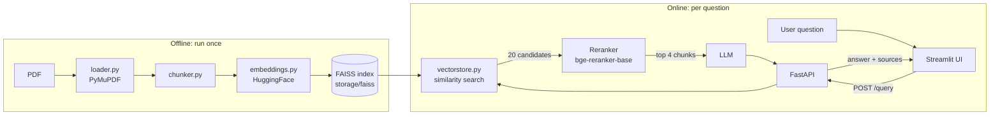

# DocuMind

**Retrieval-augmented question answering over published papers.**
Ask a question about a PDF and get an answer grounded in the paper's own text, together with the passages it was based on.

DoccuMnd is an end-to-end RAG pipeline built with LangChain, FAISS, FastAPI and Streamlit.

---

## Features

- **PDF ingestion**: extracts text from papers with PyMuPDF
- **Chunking and embedding**: splits text into passages and embeds them with a HuggingFace sentence-transformer
- **Persistent vector index**: FAISS index is built once, saved to disk and loaded when the API starts
- **Reranking**: retrieves 20 candidate passages, then reorders them with the `BAAI/bge-reranker-base` cross-encoder and keeps the best 4
- **Grounded answers**: the LLM is instructed to answer only from retrieved context and to say when the answer is not in the document
- **Source passages returned**: every response includes the chunks used to produce the answer
- **REST API**: FastAPI backend with interactive docs at `/docs`
- **Chat interface**: Streamlit front end that talks to the API

## Architecture



## Tech stack

| Layer | Technology |
|---|---|
| PDF parsing | PyMuPDF |
| Orchestration | LangChain |
| Embeddings | HuggingFace sentence-transformers |
| Vector store | FAISS (local, persisted to disk) |
| Reranker | `BAAI/bge-reranker-base` (cross-encoder) |
| LLM | OpenAI (`gpt-4o-mini` by default, replaceable) |
| Backend | FastAPI + Uvicorn |
| Frontend | Streamlit |

## Project structure

```
ragpro/
├── app/
│   ├── api/
│   │   └── main.py            # FastAPI application
│   ├── core/
│   │   └── config.py          # Paths and settings (e.g. PDF_DIR)
│   └── rag/
│       ├── loader.py          # PDFLoader: PDF -> text
│       ├── chunker.py         # Text -> chunks
│       ├── embeddings.py      # EmbeddingModel (LangChain Embeddings)
│       ├── vectorstore.py     # VectorStore: build / save / load / search (FAISS)
│       └── reranker.py        # Optional retrieval refinements
├── data/                      # Input PDFs
├── scripts/
│   └── ingest.py              # Builds and saves the index
├── storage/
│   └── faiss/                 # Saved index (generated)
├── streamlit_app.py           # Chat UI
├── .env                       # API keys (not committed)
└── README.md
```

## Getting started

### 1. Prerequisites

- Python 3.10+
- An OpenAI API key (or another LLM provider, see [Configuration](#configuration))

### 2. Install

```bash
git clone https://github.com/<mariamesaid>/DocuMind-RAG.git
cd ScholarRAG

python -m venv .venv
.venv\Scripts\activate          # Windows
# source .venv/bin/activate     # macOS / Linux

pip install fastapi uvicorn python-dotenv pydantic \
            langchain-core langchain-community langchain-huggingface langchain-openai \
            faiss-cpu pymupdf sentence-transformers streamlit requests
```

### 3. Configure

Create a `.env` file in the project root:

```
OPENAI_API_KEY=your-key-here
```

### 4. Add a paper and build the index

Place a PDF in `data/`, then run the ingestion script once:

```bash
python -m scripts.ingest
```

This loads the PDF, chunks it, embeds the chunks and saves the index to `storage/faiss`. Re-run it whenever your documents change.

### 5. Start the API

```bash
uvicorn app.api.main:app --reload
```

Open http://127.0.0.1:8000/docs to try the API in the browser.

### 6. Start the UI

In a second terminal:

```bash
streamlit run streamlit_app.py
```

The app opens at http://localhost:8501.

## API reference

### `GET /`

Health check.

```json
{ "status": "ok", "message": "Send a POST request to /query, or open /docs" }
```

### `POST /query`

Ask a question about the indexed document.

**Request**

```json
{ "question": "What is the Wikipedia game?" }
```

**Response**

```json
{
  "answer": "…",
  "sources": ["passage 1 …", "passage 2 …"]
}
```

**Example**

```bash
curl -X POST http://127.0.0.1:8000/query \
  -H "Content-Type: application/json" \
  -d '{"question": "What is the Wikipedia game?"}'
```

## Configuration

| Setting | Where | Default |
|---|---|---|
| LLM model | `app/api/main.py` | `gpt-4o-mini` |
| Embedding model | `app/api/main.py` and `scripts/ingest.py` | `BAAI/bge-small-en-v1.5` |
| Candidates retrieved before reranking (`CANDIDATES`) | `app/api/main.py` | `20` |
| Chunks kept after reranking (`TOP_K`) | `app/api/main.py` | `4` |
| Reranker model | `app/api/main.py` | `BAAI/bge-reranker-base` |
| Index location | `app/api/main.py` and `scripts/ingest.py` | `storage/faiss` |
| API address used by the UI | `API_URL` environment variable | `http://127.0.0.1:8000` |

> **Important:** the embedding model used when building the index must be the same one used at query time. Using a different model returns wrong passages without raising an error. If you change it, rebuild the index.

To use a local model instead of OpenAI, replace the `ChatOpenAI(...)` line in `main.py`, for example with `ChatOllama(model="llama3.1")` from `langchain_ollama`.

## Limitations

- The loader returns one text string per PDF, so sources do not carry page numbers.
- The index lives on local disk, which is suitable for a small document collection rather than a large corpus.
- There is no authentication on the API.
- Answer quality has not yet been measured with a formal evaluation set.

## Roadmap

- [ ] Page-level citations in the sources
- [ ] Evaluation set and metrics (retrieval hit rate, faithfulness)
- [ ] Hybrid (BM25 + vector) retrieval
- [ ] Conversation memory
- [ ] Multi-document support with metadata filters
- [ ] Docker packaging and cloud deployment

## Deployment

The Streamlit app is only the front end. To deploy it, host the FastAPI backend somewhere with a public URL (together with `storage/faiss` and the environment variables), then set `API_URL` for the Streamlit app to that address. See [DOCUMENTATION.md](DOCUMENTATION.md) for details.

## Documentation

Full technical documentation, module reference and troubleshooting guide: [DOCUMENTATION.md](DOCUMENTATION.md).

## Author

**Mariam**
<!-- Add: GitHub / LinkedIn / email -->

## License

<!-- Choose a license, e.g. MIT, and add a LICENSE file. -->
